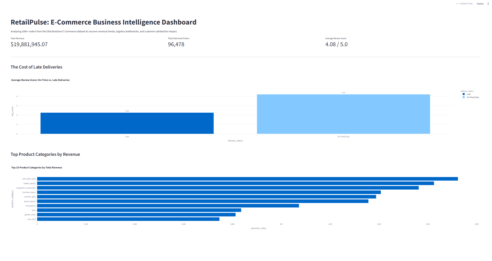

# RetailPulse: Enterprise E-Commerce Analytics & Intelligence Engine

RetailPulse is an end-to-end data engineering and business intelligence pipeline designed to process, analyze, and visualize over 100,000 transactional records from the Brazilian E-Commerce (Olist) dataset. The platform uncovers deep operational insights concerning revenue distribution, product category performance, and logistics bottleneck impacts on customer satisfaction.

---

##  Business Objectives & Problem Statement

Modern retail and e-commerce operations rely heavily on data-driven logistics and customer retention strategies. RetailPulse was engineered to solve core operational visibility challenges:
1. **Relational Data Modeling:** Consolidating multi-source transactional, customer, and logistics logs into a unified, normalized relational database architecture.
2. **Logistics Performance Analysis:** Quantifying the exact operational cost and customer satisfaction penalty associated with delivery delays.
3. **Revenue & Cohort Tracking:** Identifying top-performing product categories and tracking customer lifetime value trends over time.
4. **Interactive Streamlit Deployment:** Translating complex SQL queries and data transformations into an accessible, real-time web dashboard for stakeholders.

---

## Dashboard Preview


---
##  End-to-End Pipeline Architecture

The system follows a rigorous 4-stage data pipeline workflow:

```text
[Raw Olist CSV Datasets] 
       │
       ▼ (Stage 1: Database Ingestion)
[SQLite Relational Database (`retailpulse.db`)]
       │
       ▼ (Stage 2: Analytical Extraction)
[SQL CTEs & Window Functions (`analytical_queries.sql`)]
       │
       ▼ (Stage 3: Transformation & Feature Engineering)
[Pandas Processing & Cleaned Master Tables (`cleaned_sales_master.csv`)]
       │
       ▼ (Stage 4: Web Application Deployment)
[Interactive Streamlit Dashboard (`app.py`)] 
```
## Pipeline Breakdown:
Stage 1 - Ingestion (sql/ingest_data.py): Ingests 8 raw relational datasets (customers, orders, order_items, payments, reviews, products, sellers, and translations) into a structured SQLite database with proper table definitions.

Stage 2 - Analytical Modeling (sql/analytical_queries.sql): Leverages advanced SQL constructs including Common Table Expressions (CTEs), JULIANDAY date arithmetic, multi-table JOIN aggregations, and NTILE window functions for RFM customer segmentation.

Stage 3 - Data Cleaning & Feature Engineering (notebooks/clean_and_export.py): Handles timestamp parsing, computes precise logistics transit durations (delay_days), flags delivery status anomalies (is_late), and generates cohort retention matrices.

Stage 4 - Visualization (dashboard/app.py): Powers an interactive web application utilizing Streamlit and Plotly to render real-time revenue KPIs and logistics impact charts.

## Key Analytical Insights
The Logistics Penalty: Quantitative evaluation of delivery timestamps against customer feedback revealed that late deliveries cause a ~46.5% collapse in customer review scores—plummeting from an average of 4.21 / 5.0 for on-time shipments down to 2.25 / 5.0 when delayed.

Gross Merchandise Volume: Successfully processed and analyzed over $19.88M+ in total transaction volume across 96,478+ delivered orders, identifying high-yield product categories such as bed_bath_table, health_beauty, and sports_leisure.

## Tech Stack & Tools
Database & Querying: SQLite, SQL (CTEs, Window Functions, Relational Joins)

Data Processing & Manipulation: Python, Pandas, NumPy

Visualization & Dashboard: Streamlit, Plotly Express

Version Control: Git, GitHub

## Project Structure
```text
RetailPulse/
│
├── data/
│   ├── raw/                 # Original Olist raw CSV datasets
│   ├── cleaned/             # Processed master tables & cohort matrices
│   └── retailpulse.db       # Local SQLite relational database
│
├── dashboard/
│   └── app.py               # Interactive Streamlit dashboard script
│
├── notebooks/
│   └── clean_and_export.py  # Pandas automated data cleaning & feature engineering script
│
├── sql/
│   ├── analytical_queries.sql  # Documented enterprise SQL queries
│   ├── ingest_data.py          # Relational database ingestion script
│   └── run_queries.py          # Query verification and testing script
│
└── README.md                # Comprehensive project documentation
```

---------------------------------------------------------------------------------------------------------
## Getting Started & Local Execution

Clone this repository and execute the pipeline locally:

#### 1. Clone the repository:
git clone [https://github.com/iqragulshaikh/RetailPulse.git](https://github.com/your-username/RetailPulse.git)
cd RetailPulse

#### 2. Install Required Dependencies:
pip install streamlit plotly pandas numpy

#### 3. Step 1: Build Database & Ingest Raw Data:
python sql/ingest_data.py

#### 4. Step 2: Clean Data & Generate Master Exports:
python notebooks/clean_and_export.py

#### 5. Step 3: Launch the Interactive Dashboard:
streamlit run dashboard/app.py
